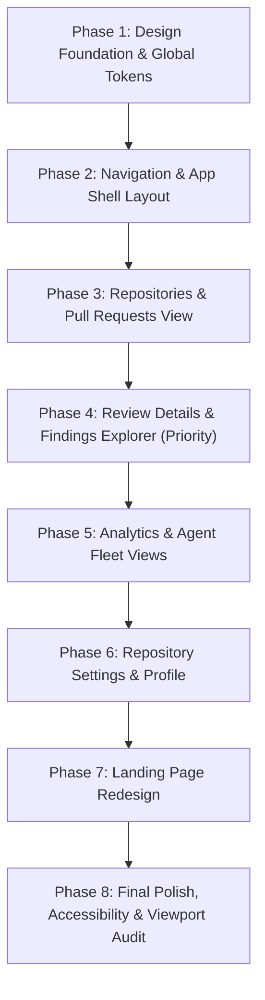

# CodeGuardian AI — UI Implementation Roadmap

## 1. Executive Summary & Design Baseline

This document defines the sequential implementation plan for the **CodeGuardian AI** UI/UX redesign. The goal is to transform CodeGuardian AI into a premium, modern, professional DevSecOps SaaS platform while preserving **100% of existing functionality, backend contracts, data structures, and test suites**.

The baseline documents approved for this redesign are:
1. `UI_UX_AUDIT.md`
2. `DESIGN_SYSTEM_PLAN.md`
3. `PAGE_REDESIGN_PLAN.md`

---

## 2. Final Design Decisions & Inconsistency Resolution

| Dimension | Resolution & Specification |
|---|---|
| **Visual Identity** | Dark, professional developer-platform aesthetic. Canvas `#0A0E1A`, elevated surfaces `#0F1525`, cards `#141C2E`. Refined indigo/violet accent (`#818CF8` / `#6366F1`). Distinct border hierarchy (`#1E293B`, `#293548`, `#384860`). Avoid generic monochrome blue-gray wash; establish clear visual contrast between headings, body text, metadata, and borders. |
| **Typography** | Retain existing variable fonts: **Plus Jakarta Sans Variable** (UI headings & body) and **JetBrains Mono Variable** (code, diffs, metrics, technical metadata). No font swaps. Establish strict hierarchy: 14–16px regular body, min 13–14px for descriptions/settings/agent summaries, and reserve 11–12px exclusively for secondary tags/timestamps. Verify WCAG AA (≥4.5:1 text, ≥3:1 UI components). |
| **Navigation** | **Hybrid Sidebar + Top Bar**. Preserve all existing React Router routes (`/`, `/repos`, `/repos/:owner/:repo`, `/repos/:owner/:repo/pulls/:number`, `/reviews/:reviewId`, `/profile`, `/auth/*`). Preserve `tab` and `installation_id` query params, back/forward history, and deep linking. Keep `/profile` dedicated and distinct from repo settings. Presentation-layer sidebar integration ensures zero risk to state management or auth boundaries. |
| **Component Preservation** | Reuse and enhance existing core components: `Button`, `IconButton`, `Tabs`, `SeverityBadge`, `StatCard`, `SearchInput`, `InstallationPicker`, `ProgressBar`, `AsyncState`, and review components. Retain test-critical CSS hooks (e.g. `bg-primary-600`, `bg-severity-*-bg`) while elevating styling with modern borders, subtle shadows, and focus rings. |
| **Data & Analytics** | Strictly preserve real backend-derived metrics, severity counts, coverage semantics (including `unknown` and incomplete coverage warnings), and agent outcomes. **Zero fabricated metrics, fake trends, or simulated timestamps.** |
| **Feedback & Interactions** | Skeletons for loading states; clear inline validation & error messages. Retain native file-input behavior for custom standards upload. Preserve all error banners (`actionError`, write error states). Add restrained CSS micro-transitions respecting `prefers-reduced-motion`. |
| **Backend Protection** | **100% frontend presentation task.** Zero changes to backend files, database models, API contracts, OAuth logic, GitHub App permissions, review execution, auto-fix approval logic, or polling intervals. |

---

## 3. Implementation Phases & Execution Order

---

### Phase 1 — Design Foundation & Tokens
**Objective**: Establish the unified color, typography, border, elevation, and component baseline tokens in CSS, and update core visual primitives without breaking existing tests.

- **Files Targeted**:
  - `frontend/src/index.css`: Add semantic layer variables, refine contrast while keeping all existing primary/severity class aliases intact.
  - `frontend/src/components/common/Button.tsx`: Add subtle shadow, border refinement, smooth transitions, focus rings, keeping variant class names expected by tests.
  - `frontend/src/components/common/SeverityBadge.tsx`: Refine badge typography, padding, svg icon alignments, preserving `bg-severity-*-bg` classes and aria status attributes.
  - `frontend/src/components/common/SearchInput.tsx`: Improve border contrast, placeholder contrast, and keyboard focus states.
  - `frontend/src/components/common/ProgressBar.tsx`: Refine bar track contrast and segment animations.
- **Verification Gate**:
  - `npm test`: All 21 test suites must pass.
  - `npm run build`: Zero TypeScript/Vite errors.

---

### Phase 2 — Navigation and Application Layout
**Objective**: Implement the hybrid layout shell with an elevated top bar, contextual repository sidebar, mobile drawer navigation, breadcrumbs, and consistent content framing.

- **Files Targeted**:
  - `frontend/src/components/layout/AppLayout.tsx`: Upgrade shell into a responsive layout supporting top navigation, optional repository contextual sidebar (when within `/repos/:owner/:repo`), and main content container with consistent max-width (`max-w-7xl`).
  - `frontend/src/components/layout/Navbar.tsx`: Enhance visual hierarchy, improve user avatar & GitHub login status, retain all link routes (`/repos`, `/profile`), sign-out button, and `actionError` alert.
  - `frontend/src/components/layout/Sidebar.tsx` *(new presentational component)*: Contextual navigation for repository sections (Pull Requests, Analytics, Agents, Settings) that seamlessly syncs with existing tab routing.
  - `frontend/src/components/layout/ContextBar.tsx`: Enhance breadcrumb readability, add high-contrast repo badges and branch chips, preserve test IDs and text content.
- **Verification Gate**:
  - Direct URL access to `/`, `/repos`, `/repos/:owner/:repo`, `/profile`, `/reviews/:reviewId`.
  - Browser back/forward navigation.
  - `npm test` & `npm run build` green.

---

### Phase 3 — Connected Repositories and Pull Requests
**Objective**: Elevate the repository selection and pull requests list experiences with polished cards, clear status indicators, and intuitive filtering.

- **Files Targeted**:
  - `frontend/src/pages/RepoListPage.tsx`: Modernize repo grid cards, installation picker header, empty states, search bar layout, and refresh button.
  - `frontend/src/components/common/InstallationPicker.tsx`: Improve dropdown styling, contrast, and organization selection readability.
  - `frontend/src/components/dashboard/PullsTab.tsx`: Redesign PR cards with crisp review status badges, author metadata, branch indicators, and clean trigger review action.
  - `frontend/src/components/reviews/TriggerReview.tsx`: Improve manual review initiation modal/form styling and feedback.
- **Verification Gate**:
  - Installation switching retains state.
  - Pull request trigger buttons and status indicators preserve all data attributes.
  - `npm test` & `npm run build` green.

---

### Phase 4 — Review Details and Findings Explorer (Core Priority)
**Objective**: Redesign the centerpiece of CodeGuardian AI — the review detail page, analysis status overview, severity breakdown, finding cards, agent timeline, and auto-fix review workflow.

- **Files Targeted**:
  - `frontend/src/pages/ReviewDetailPage.tsx`: Redesign sticky summary header, review metadata grid, quick-filter tabs, and error/status banners.
  - `frontend/src/components/reviews/ReviewPresentation.tsx`: Improve findings layout, code block syntax contrast, agent badge tags, and expandable finding details.
  - `frontend/src/components/reviews/FindingsList.tsx`: Enhance severity filtering, search in findings, file grouping, and empty finding states.
  - `frontend/src/components/reviews/AgentTimeline.tsx`: Modernize agent status cards, execution time badges, and progress bar visualization.
  - `frontend/src/components/reviews/AutofixActions.tsx`: Enhance fix branch creation, diff preview, approval/rejection banner, and write-operation feedback without touching API logic.
- **Verification Gate**:
  - Real write contracts preserved (fix branch creation, approval/rejection, standards reset).
  - Polling interval and auto-refresh mechanisms remain completely intact.
  - `npm test` & `npm run build` green.

---

### Phase 5 — Analytics and Agent Fleet
**Objective**: Polish the metrics dashboard, agent outcome charts, and fleet diagnostic views with accessible visualizations and high-contrast typography.

- **Files Targeted**:
  - `frontend/src/components/dashboard/AnalyticsTab.tsx`: Modernize KPI cards (total reviews, findings by severity, coverage rates), historical review table, and trend indicators.
  - `frontend/src/components/dashboard/AgentsTab.tsx`: Elevate the 4 specialist agent profiles (Security, Quality, Compliance, Dependencies), configuration badges, and execution stats.
  - `frontend/src/components/dashboard/AgentOutcomeChart.tsx`: Improve CSS/SVG bar chart aesthetics, contrast, legend readability, and tooltip clarity.
  - `frontend/src/components/common/AgentHistoryDots.tsx`: Preserve status dot accessibility labels (`Security: 0 ok, 1 degraded...`) while improving visual fidelity.
- **Verification Gate**:
  - No altered metric calculations or fake data.
  - Incomplete coverage and degraded agent warnings remain clearly prominent.
  - `npm test` & `npm run build` green.

---

### Phase 6 — Repository Settings and User Profile
**Objective**: Deliver a clean, professional configuration interface for repository review modes, custom coding standards upload, and user profile management.

- **Files Targeted**:
  - `frontend/src/components/dashboard/SettingsTab.tsx`: Reorganize settings into clear visual cards (Execution Mode, Security Rules, Custom Standards, Policy Enforcement), improve file upload presentation, and enhance confirmation modals.
  - `frontend/src/pages/ProfilePage.tsx`: Modernize profile information card, administered installations list, and global policy broadcast controls.
- **Verification Gate**:
  - Multipart upload flow for standards file intact.
  - "Reset to defaults" and "Confirm reset" dialogs functional.
  - Policy broadcast to all administered installations functions properly.
  - `npm test` & `npm run build` green.

---

### Phase 7 — Landing Page Redesign
**Objective**: Build a compelling, modern developer-focused landing page showcasing CodeGuardian AI's multi-agent autonomous DevSecOps capabilities.

- **Files Targeted**:
  - `frontend/src/pages/HomePage.tsx`: Implement high-contrast hero with terminal/code preview, interactive-feel agent cards (Security, Quality, Architecture, Dependencies), workflow pipeline graphic, features grid, and prominent GitHub login CTA.
- **Verification Gate**:
  - Responsive across all viewports (1440px down to 390px).
  - GitHub authentication CTA triggers OAuth flow with proper return redirect.
  - `npm test` & `npm run build` green.

---

### Phase 8 — Final Polish, Accessibility & Viewport Audit
**Objective**: Cross-page visual consistency check, WCAG AA compliance verification, focus/hover audit, responsive layout testing across 5 viewport breakpoints, and final build validation.

- **Tasks**:
  - Verify WCAG AA contrast (≥4.5:1 text, ≥3:1 UI components) on all screens.
  - Test viewports: 1440px (Desktop Large), 1280px (Desktop Standard), 1024px (Tablet Landscape), 768px (Tablet Portrait), 390px (Mobile).
  - Run full test suite (`npm test`) and production build (`npm run build`).
  - Capture browser screenshots to verify visual excellence and absence of layout regressions.
  - Produce final completion report.
