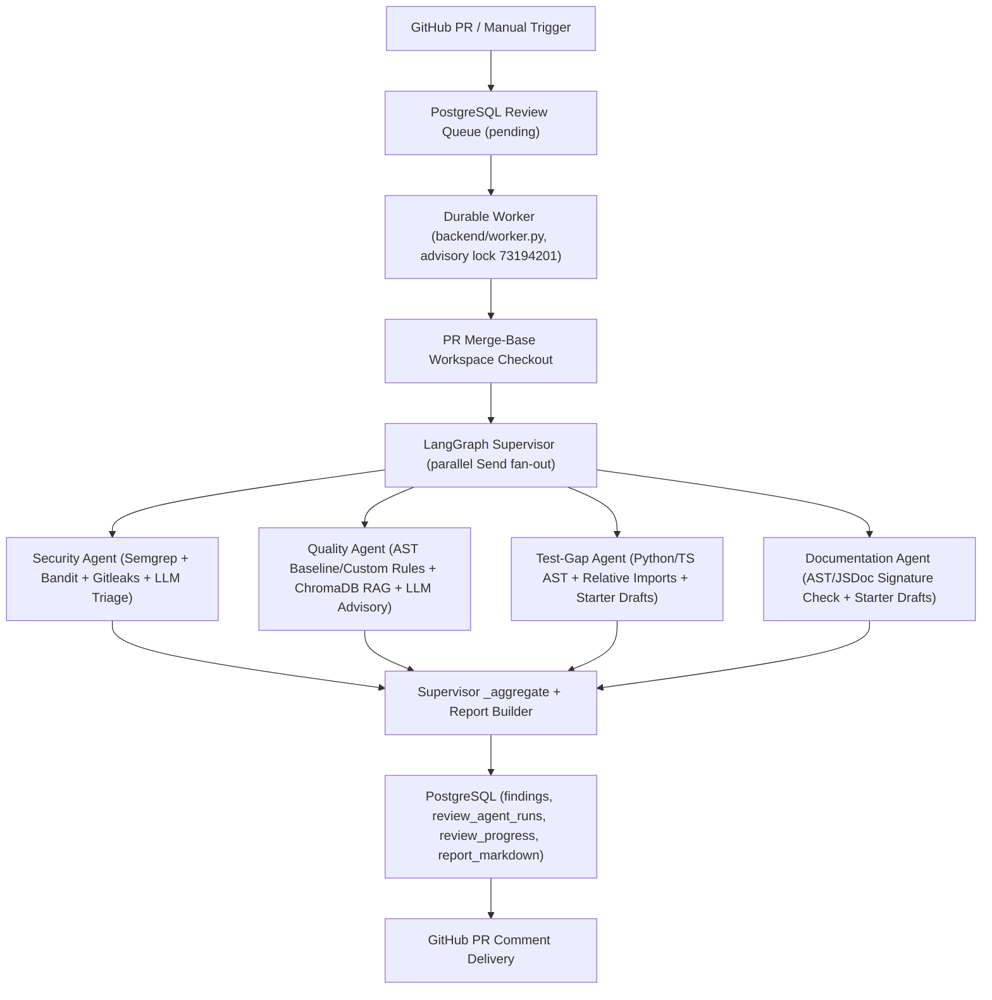

# CodeGuardian AI — Final Backend & Multi-Agent Acceptance Report

**Branch:** `codex/durable-review-pipeline`  
**Base Verified Checkpoint:** `634f62ed0ba79cc0a4d914dce90b310212904024`  
**Live Acceptance Review:** Review `#92` on `DhyanMehta/flask-task-api` PR `#5` (`acceptance/final-backend-20261126`)  

---

## 1. Executive Summary

All diagnosed backend and multi-agent defects (`BE-01` through `BE-05`) have been resolved, the default coding standards corpus has been restructured and re-ingested into a new versioned ChromaDB collection, 286 focused backend regression tests pass, all three security scanners (`bandit`, `semgrep`, `gitleaks`) pass runtime verification, and one controlled end-to-end live multi-agent acceptance review (`#92`) completed with all four specialist agents recording `ok` and posting its severity-ranked report to GitHub.

---

## 2. Architecture & Deterministic Boundary



---

## 3. Diagnosed Defects & Implemented Fixes

| ID | Component | Root Cause | Fix Implemented |
|---|---|---|---|
| **BE-01** | `backend/agents/quality_agent.py`, `backend/agents/frontend_analysis.py`, `backend/rag/retriever.py` | Quality Agent skipped deterministic `_discover_verified()` when RAG retrieval failed or returned no passages, and `frontend_analysis.py` raised `ValueError` on empty retrieval. | Added `load_policy_passages()` and `resolve_supported_rules()` with bundled `baseline_passages()`. Deterministic AST checks now run even when RAG retrieval fails or returns empty context, while advisory LLM review is skipped and `DEGRADED` status is recorded truthfully. |
| **BE-02** | `backend/agents/quality_rules.py`, `backend/agents/frontend_analysis.py` | `frontend_analysis.py` only checked `"python" not in ...`, allowing Java-only (or other non-JS/TS) rules to flag TypeScript files; `_FOREIGN_LANGUAGE` omitted several languages. | Added explicit `target_language` (`python` vs `frontend`) item-level and source-file scoping in `quality_rules.py` and wired `frontend_analysis.py` to `resolve_supported_rules(..., target_language="frontend")`. |
| **BE-03** | `backend/agents/quality_rules.py` | Splitting by paragraph (`\n\s*\n`) allowed `optional` in a neighboring bullet to suppress `future_annotations_import`, and `_LENGTH`/`_PARAMETERS` lacked negation checks. | Added `_split_items()` to parse individual Markdown list items/clauses and added `_NEGATION` + `_OPTOUT` guards across all three deterministic rules. |
| **BE-04** | `backend/agents/test_gap_agent.py` | `_discover_existing_tests()` ignored `ast.ImportFrom.level`, failing to resolve package-relative imports (`from .sample import score`). | Resolved relative `ast.ImportFrom` (`node.level >= 1`) against `Path(rel_test_path).parent.parts` (handling `from .mod import fn`, `from ..mod import fn`, and `from . import mod`). |
| **BE-05** | `backend/agents/supervisor.py` | `_aggregate()` defaulted missing `agent_outcomes` entries to `AgentOutcome.OK.value`. | Changed default to `AgentOutcome.UNKNOWN.value` and logged `unknown` agent outcomes explicitly. |

---

## 4. Coding Standards Upgrade & Precedence Model

- **Python Standards:** [python_coding_standards.md](file:///d:/Dhyan/Self%20Projects/Code-Guardian/backend/rag/standards/python_coding_standards.md) organized into Categories **A** (Deterministically Enforceable Rules: `maximum_function_length` = 40 logic lines, `maximum_positional_parameters` = 5, `future_annotations_import`), **B** (AI-Assisted Advisory Guidance: PEP 8 naming, complexity <= 10, error handling, imports, typing, PEP 257 docstrings), **C** (Python-Specific Conventions), and **D** (Guidance Not Currently Enforceable Deterministically).
- **Frontend Standards:** [frontend_coding_standards.md](file:///d:/Dhyan/Self%20Projects/Code-Guardian/backend/rag/standards/frontend_coding_standards.md) added with explicit JavaScript/TypeScript/JSX/TSX scoping so frontend and Python rules never cross-contaminate.
- **ChromaDB Ingestion:** Re-ingested via `backend.rag.ingest` (`10` passages across `2` documents into a new active versioned collection without overwriting historical or custom installation collections).
- **Precedence:** Built-in baseline rules apply by default; explicit applicable custom rules override the matching baseline rule; explicit opt-outs/negations disable only the opted-out rule; incomplete custom standards or retrieval failures never disable unrelated baseline deterministic checks.

---

## 5. Verification Results

### 5.1 Focused Backend Regression Suite

Command:
```powershell
.\backend\venv\Scripts\python.exe -B -m pytest backend/tests/test_agents backend/tests/test_rag backend/tests/test_agent_correctness.py backend/tests/test_pipeline_recovery.py backend/tests/test_release_correctness.py backend/tests/test_services/test_report_builder.py -p no:cacheprovider --tb=short
```
Result: **`286 passed`** (`0` failed).

### 5.2 Runtime Scanner Verification

Command (outside sandbox for native Semgrep Windows `socketpair` support):
```powershell
.\backend\venv\Scripts\python.exe -m scripts.verify_backend_runtime
```
Result: `bandit` (`ok`, 2 findings: `B101`, `B307`), `semgrep` (`ok`, 2 findings: `python-assert-used`, `python-dangerous-eval`), `gitleaks` (`ok`, 0 findings).

### 5.3 Controlled Live Multi-Agent Acceptance Review

- **Target Repository & PR:** `DhyanMehta/flask-task-api`, PR `#5` (`acceptance/final-backend-20261126`, head `f3b81a99dfd340763d0184fdb10033ac12731665`, unmerged).
- **Health Checks:** `GET /health/live` -> `200`, `GET /health/ready` -> `200` (`database`, `chromadb`, `worker`, `configuration` all `ok`).
- **Review Record:** `review_id=92`, `status="completed"`, `delivery_status="posted"`, `attempt=1`, `standards_version="coding_standards_default_63207096d5b64f41ab318c59dab15c66"`.
- **Specialist Outcomes (`review_agent_runs`):**
  - `security`: `ok`, `8` findings (`semgrep`, `bandit`, `gitleaks` all `completed: true`)
  - `quality`: `ok`, `4` findings (`maximum_function_length` on `oversized_workflow_step`, `maximum_positional_parameters` on `excessive_positional_args`, `future_annotations_import` on both PR files)
  - `test_gap`: `ok`, `6` findings (correctly excluded `tests/test_acceptance_audit_fixture.py` as reference input and did not flag negative controls `covered_helper`, `well_documented_helper`, `compliant_summary`)
  - `documentation`: `ok`, `10` findings (`Docstring missing` on `undocumented_public_worker`, `Docstring outdated` on `stale_doc_handler`, plus `Docstring incomplete` where parameter/return docs were omitted)
- **GitHub Delivery:** Comment `#7200349606` posted at `https://github.com/DhyanMehta/flask-task-api/pull/5#issuecomment-7200349606` (`6405` chars).
- **Cleanup:** Worker and API server processes stopped after verification; PR `#5` left open and unmerged; no auto-fix branch created.
